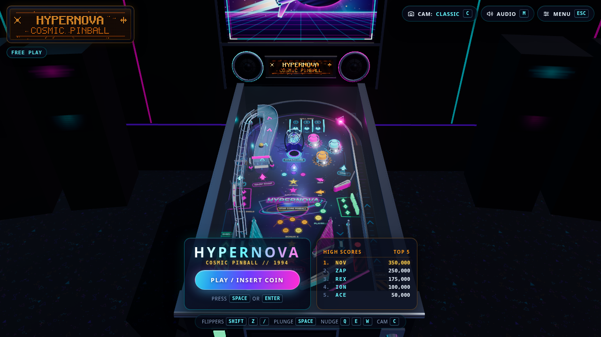
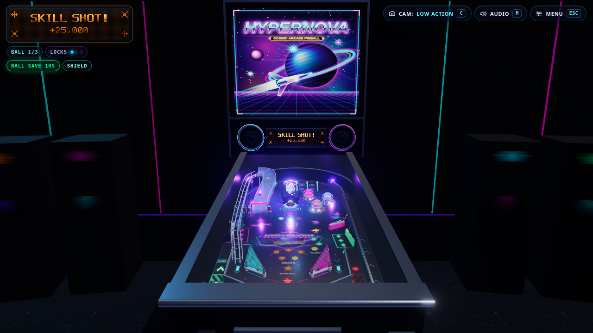
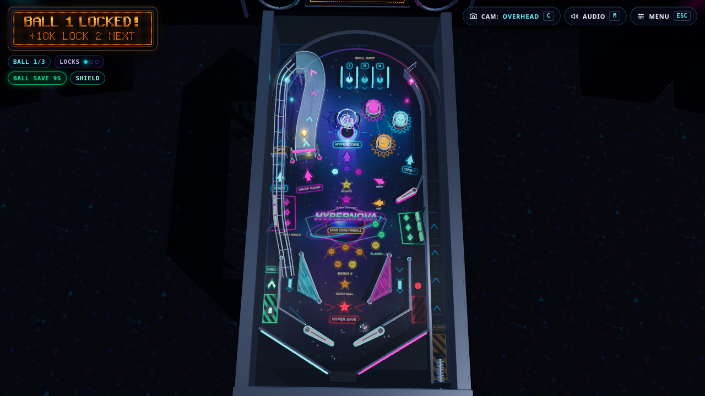

# HYPERNOVA — 3D Sci-Fi Arcade Pinball

**HYPERNOVA** is a 1990s cosmic sci-fi 3D pinball machine running in the browser with **TypeScript**, **Three.js**, **Rapier3D (WASM)**, and the **Web Audio API**.

Everything in the game—cabinet hardware, clear-coated playfield artwork, backlit sci-fi translite, custom GLSL plasma reactor, `128×32` amber Dot-Matrix Display, studio chrome reflections, and electromechanical/synth sound effects—is **100% procedurally generated in code at runtime**, with zero external 3D models, image textures, or audio files.



## Screenshots

| Low Action View (Cabinet & Backbox) | Overhead Playfield View |
| :---: | :---: |
|  |  |

## Highlights

- **480 Hz Hybrid 3D Physics**: Powered by `@dimforge/rapier3d-compat` with Continuous Collision Detection (CCD) on up to 3 simultaneous steel pinballs, collision-layered elevated ramps (weak shots stall and roll back cleanly), a gravity-integrated spline return for the 4-wire chrome wireform habitrail, calibrated `I-O-N` Skill Shot spring mechanics, and an automatic anti-stuck watchdog.
- **Full 1990s Arcade Ruleset**:
  - **Skill Shot (`+25,000`)** & **Flipper Lane Change** across the top `I-O-N` rollover lanes (completing `I-O-N` awards `+10,000` and steps End-of-Ball Bonus Multiplier up to `6X`)
  - **Elevated Warp Ramp Combos** (`+15,000 × combo` up to `5X`, returning down the left chrome wireform directly to the left inlane)
  - **Hypercore Lock & 3-Ball Multiball**: Lock 3 balls in the center plasma reactor saucer to erupt into 3-ball **HYPERNOVA MULTIBALL** with alternating **Jackpots (`+100,000`)** and **Super Jackpots (`+250,000`)**
  - **`R-A-Y` 3-Bank Drop Targets** (`+3,000` each, `+15,000` bank clear — relights Left Outlane **Shield Kickback** and lights **Hypercore Lock**)
  - **Right 3-Bank Standups** (`+2,500` each, `+12,000` clear — steps timed `2X → 3X → 5X` Playfield Multiplier)
  - **3 Pop Bumpers** (`+1,500`, upgrading to **Super Jets `+5,000`** after 15 hits), **Twin Slingshots**, **Left Orbit Spinner**, **Upper-Right Mini-Flipper**, **12s / 15s Hyper Save**, **Extra Ball** (`500,000` pts or 2nd Multiball Jackpot), and **Top-5 High Score** persistence with 3-letter arcade initials
  - **Damped Pendulum Nudge & Tilt**: Physical 2D plumb-bob simulation with `DANGER` warnings and 3rd-strike `TILT`
- **Procedural 3D Visuals & Lighting**:
  - Full `6.5°`-pitched 3D cabinet in a dim arcade room with brushed steel rails, coin door, animated plunger rod, backlit translite, stereo speaker rings, and selectable cabinet glass reflections (`Subtle` / `Realistic` / `Off`)
  - `2048×4096` procedural Canvas2D playfield albedo, roughness, and bump maps + `1024×1024` backlit translite
  - Custom GLSL swirling **Hypercore** plasma reactor orb, 47-lamp animated lightshow matrix, ACES Filmic tone mapping + selective `UnrealBloomPass`, and 4 switchable cameras (`Classic`, `Dynamic`, `Low Action`, `Overhead`)
  - Authentic 4-shade `128×32` amber LED Dot-Matrix Display mirrored cleanly between the 3D backbox and the HUD
- **Procedural Web Audio Engine**: Real-time synthesized flipper/bumper/slingshot/drop-target/saucer solenoids, velocity-modulated wood and chrome wireform rolling beds, stereo panning, arcade synth stingers, looping cosmic bassline, and a soft-ceiling master limiter.

## Controls

| Action | Keys / Input |
| :--- | :--- |
| **Left Flipper / Lane Change Left** | `Left Shift`, `Z`, `A`, `←` |
| **Right Flipper (+ Upper Mini-Flipper) / Lane Change Right** | `Right Shift`, `/`, `D`, `→` |
| **Plunger (Hold & Release) / Start Game** | `Space`, `Enter`, `↓` |
| **Table Nudge (Left / Right / Up)** | `Q` or `X` / `E` or `.` / `W` or `↑` |
| **Cycle Camera (`Classic`, `Dynamic`, `Low Action`, `Overhead`)** | `C` |
| **Mute Audio** | `M` |
| **Pause & Settings Drawer** | `Esc` or `P` |
| **Mouse** | Drag on-screen Plunger gauge |
| **Touch** | Drag Plunger · Corner Flipper & Nudge pads |

## Getting Started

Requires **Node.js 22+** (or Node 20.19+).

```bash
npm install
npm run dev
```

Open the local URL printed by Vite (default `http://localhost:5173`) in a WebGL2-capable browser.

### Scripts

```bash
npm run dev        # Start Vite dev server
npm run build      # Build production bundle into dist/
npm run preview    # Preview production build locally
npm test           # Run Vitest unit & headless Rapier3D physics tests
npm run typecheck  # Run strict TypeScript typecheck (tsc --noEmit)
```

## Project Structure

```text
src/
├── config/
│   ├── constants.ts          # Physical scale, 6.5° gravity, 480 Hz timing, collision groups, palette
│   ├── types.ts              # Shared interfaces for physics, rules, lamps, DMD, HUD, and settings
│   └── tableLayout.ts        # Single parametric table layout shared by Rapier3D and Three.js
├── physics/
│   ├── PhysicsWorld.ts       # Rapier3D 480 Hz substep loop & collision/sensor event dispatch
│   ├── TableColliders.ts     # Playfield, walls, lofted Warp Ramp deck/sidewalls, glass ceiling
│   ├── FlipperPhysics.ts     # High-speed tapered kinematic flippers (zero tunneling + cradling)
│   ├── PlungerPhysics.ts     # Calibrated spring curve with I/O/N Skill Shot sweet spots
│   ├── WireformRail.ts       # Gravity-integrated spline return for the chrome wireform habitrail
│   └── BallManager.ts        # Multi-ball lifecycle, ramp layer transitions, saucer hold, anti-stuck
├── game/
│   ├── GameState.ts          # Pure deterministic arcade ruleset & scoring state machine
│   ├── TiltSystem.ts         # Damped 2D plumb-bob nudge & tilt warning simulation
│   ├── LampController.ts     # 47-lamp playfield LED matrix & scripted lightshows
│   └── HighScores.ts         # localStorage Top-5 leaderboard with safe fallback
├── graphics/
│   ├── SceneManager.ts       # WebGLRenderer, ACES tone mapping, selective bloom, context recovery
│   ├── EnvironmentBuilder.ts # Procedural dark-arcade HDR studio reflections & room backdrop
│   ├── CabinetBuilder.ts     # Pitched 3D cabinet, legs, coin door, backbox, translite, glass
│   ├── PlayfieldMeshBuilder.ts # Parametric 3D playfield hardware, ramp, wireforms, LED inserts
│   ├── PlayfieldTextures.ts  # 2048×4096 procedural playfield albedo/roughness/bump generator
│   ├── BackboxTextures.ts    # 1024×1024 procedural backlit sci-fi translite generator
│   ├── HypercoreToy.ts       # Custom GLSL plasma reactor orb & counter-rotating chrome gimbals
│   ├── ParticleSystem.ts     # Pooled InstancedMesh impact spark bursts
│   ├── CameraController.ts   # 4 switchable cameras, attract orbit, ball tracking & nudge shake
│   └── DmdRenderer.ts        # 128×32 4-shade amber LED Dot-Matrix Display + bitmap fonts
├── audio/
│   └── SoundEngine.ts        # Procedural Web Audio solenoids, rolling beds, synths & limiter
├── ui/
│   └── HudController.ts      # Glassmorphic HUD, DMD mirror, plunger gauge, settings & initials modal
├── style.css
└── main.ts                   # Application bootstrap, input handling & simulation/render loop
tests/
├── gameState.test.ts         # Ruleset, scoring, combos, multiball, bonus & extra ball tests
├── tiltSystem.test.ts        # Damped pendulum nudge, warning & tilt tests
├── wireformRail.test.ts      # Spline descent & inlane handoff tests
└── physicsIntegration.test.ts # Headless Rapier3D tests (flippers, Skill Shot, ramp climb/rollback)
```

## Tech Stack

- **Three.js** (`0.187.0`) — PBR rendering, post-processing bloom, custom GLSL shaders
- **Rapier3D** (`@dimforge/rapier3d-compat` `0.21.0`) — 3D rigid-body WASM physics with CCD
- **TypeScript** (`7.0.2`), **Vite** (`8.3.8`), **Vitest** (`5.1.1`)
- **Web Audio API** & **Canvas 2D API** — procedural sound synthesis and texture generation

## License

[MIT](LICENSE)
